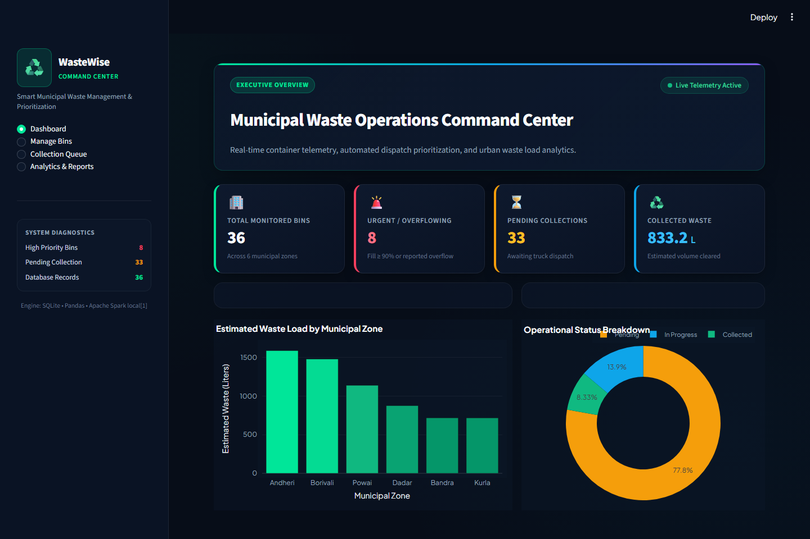
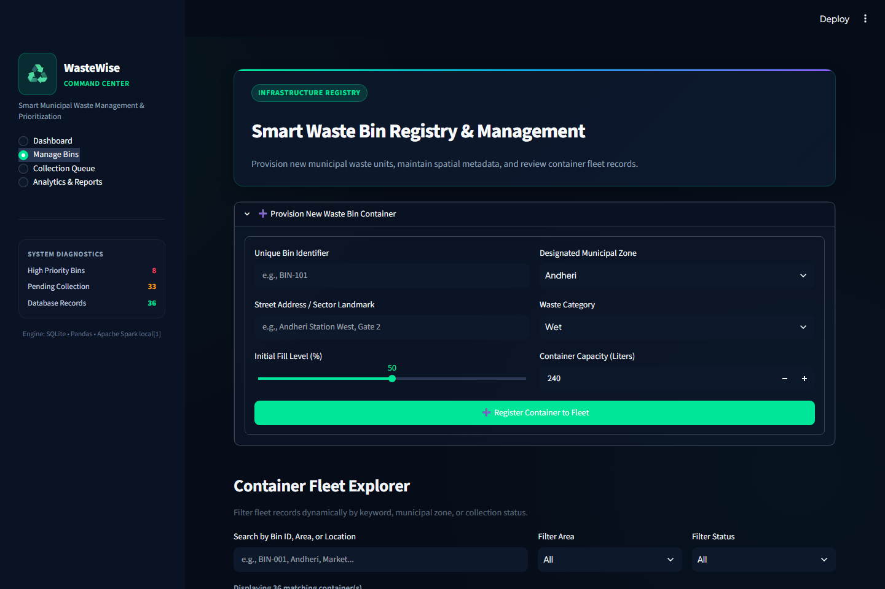
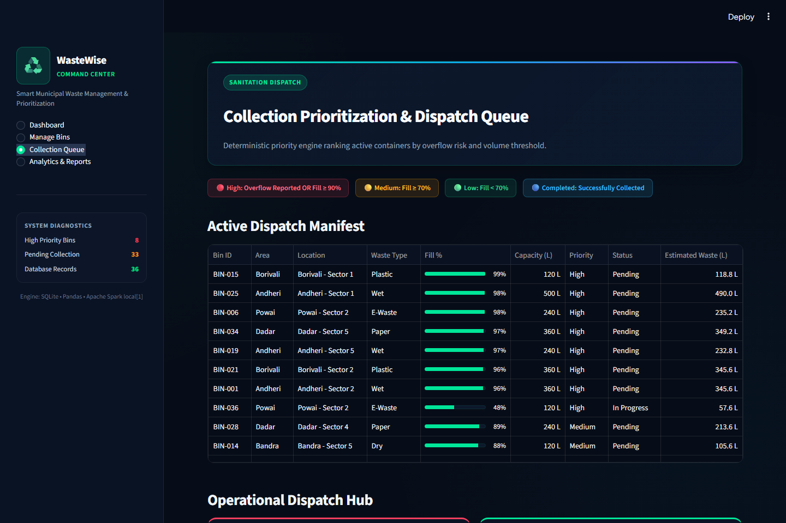
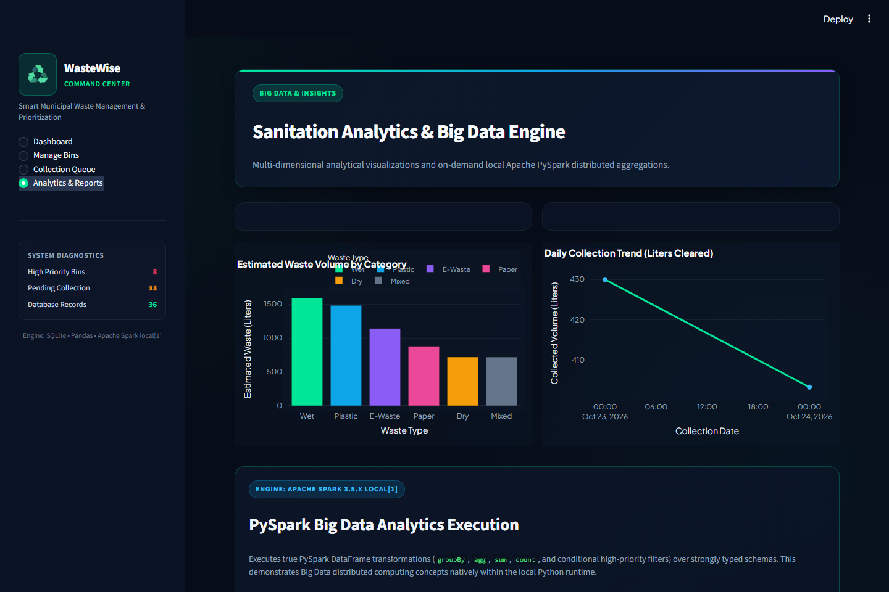
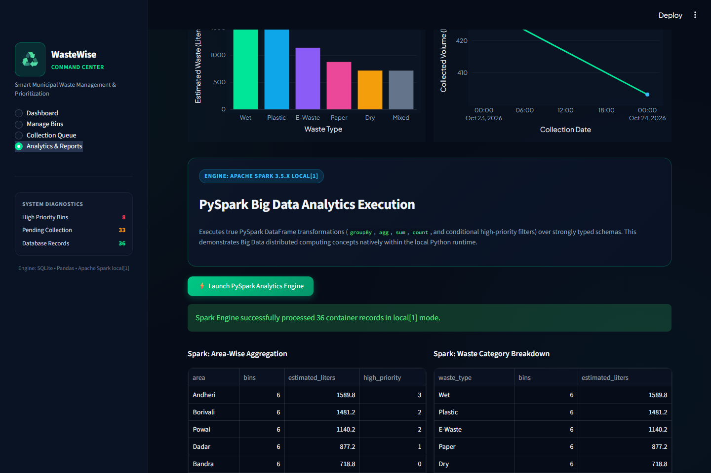
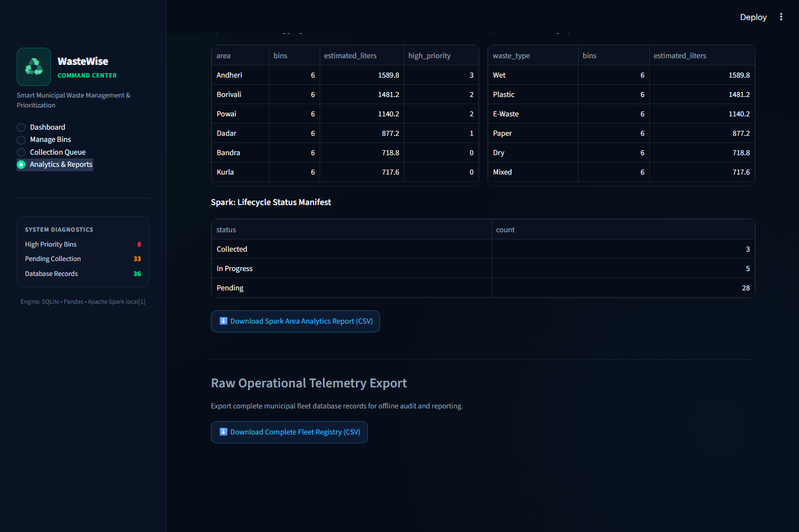

# ♻️ WasteWise — Smart City Waste Management Command Center

[](https://www.python.org/)
[](https://streamlit.io/)
[](https://spark.apache.org/)
[](https://www.sqlite.org/)
[](https://plotly.com/)
[](LICENSE)

An executive-grade, data-driven municipal waste management platform featuring real-time container fill telemetry, deterministic collection prioritization, dark Plotly visualizations, and on-demand local **Apache PySpark** Big Data aggregations.

---

## 📌 Problem Statement

Municipal waste collection in rapidly growing urban centers faces several operational inefficiencies:
- **Unplanned Overflow:** Bins overflow before scheduled pickups, causing hygiene and environmental hazards.
- **Suboptimal Dispatching:** Sanitation trucks often service half-empty bins while critical, overflowing bins are neglected.
- **Lack of Analytical Visibility:** Municipal authorities lack unified metrics to analyze waste production patterns by area, waste category, and collection efficiency.

**WasteWise** addresses these issues by providing a responsive, interactive management dashboard that automatically prioritizes bin collection schedules using deterministic rules and runs distributed-style Big Data analytical queries over operational records.

---

## ✨ Features

- **📊 Central Operations Command Center:** Real-time visibility into key operational KPIs:
  - Total monitored bins across municipal zones.
  - Urgent/overflowing bins requiring immediate collection.
  - Pending collection queue length.
  - Cumulative collected waste volume (estimated liters).
- **🚨 Smart Collection Prioritization Engine:**
  - **High:** Bins with reported overflow or fill level $\ge 90\%$.
  - **Medium:** Bins with fill level between $70\%$ and $89\%$.
  - **Low:** Bins with fill level below $70\%$.
  - **Completed:** Fully collected bins removed from active priority queues.
- **📝 Bin Lifecycle Management (CRUD):** Add, update, delete, search, and filter bins by municipal area, status, and waste type.
- **⚡ PySpark Big Data Analytics:** Executes true local Apache Spark (`local[1]`) DataFrames with strongly-typed schemas to run multi-dimensional grouping, sum, and conditional count aggregations.
- **📈 Dark Plotly Visualizations:** Dynamic visual breakdowns of waste generation by category and daily collection completion trends.
- **📥 Data Portability:** Download full raw operational records and PySpark analytical summary tables in CSV format.
- **🔄 Auto-Seeding Database:** Self-initializing SQLite database with 36 reproducible simulated municipal bins across 6 major zones.

---

## 🏗️ Architecture & Workflow

```text
┌─────────────────────────────────────────────────────────────┐
│                   Streamlit Web Interface                   │
│      (Dashboard, Bin Management, Queue, Analytics)          │
└──────────────────────────────┬──────────────────────────────┘
                               │
                ┌──────────────┴──────────────┐
                ▼                             ▼
   ┌─────────────────────────┐   ┌───────────────────────────┐
   │    SQLite Database      │   │     Analytics Engine      │
   │   - Bin CRUD operations │   │                           │
   │   - 36 Seeded Bins      │   │  ├─ Pandas & Plotly (KPIs)│
   │   - Connection pooling  │   │  └─ PySpark (Aggregations)│
   └─────────────────────────┘   └───────────────────────────┘
```

---

## 🛠️ Technology Stack

| Component | Technology | Version | Purpose |
| :--- | :--- | :--- | :--- |
| **Language** | Python | `3.11.x` | Core backend logic & analytics |
| **Frontend UI** | Streamlit | `>= 1.39, < 2.0` | Interactive web dashboard and user controls |
| **Big Data Engine** | Apache PySpark | `>= 3.5, < 3.6` | Distributed-style DataFrame aggregations |
| **Data Analysis** | Pandas | `>= 2.2, < 3.0` | In-memory filtering and metric computations |
| **Visualizations** | Plotly Express | `>= 5.24, < 7.0` | Interactive analytical charts |
| **Persistence** | SQLite3 | Native | Zero-configuration local database storage |
| **JVM Runtime** | Java OpenJDK | `17` (Temurin) | Required runtime for PySpark / Apache Spark |

---

## 📁 Repository Structure

```text
WasteWise/
├── .gitignore              # Ignores venv, SQLite DB, cache, and sensitive files
├── .streamlit/
│   └── config.toml         # Streamlit dark theme & midnight-navy UI settings
├── screenshots/            # Application screenshots and command center media
├── README.md               # Project documentation and setup guide
├── LICENSE                 # MIT License
├── requirements.txt        # Pinned Python package dependencies
├── app.py                  # Streamlit application UI, navigation, and pages
├── analytics.py            # Pandas metrics and PySpark SparkSession aggregations
├── database.py             # SQLite schema, context-managed connection, and seed data
└── tests/
    └── test_core.py        # Automated unit tests for database, validation, and PySpark
```

---

## ⚙️ Prerequisites & Setup

### 1. Java 17 Development Kit (Required for PySpark)
PySpark 3.5 requires **Java 17**:
1. Download and install [Eclipse Adoptium Temurin OpenJDK 17](https://adoptium.net/temurin/releases/?version=17).
2. Set your system `JAVA_HOME` environment variable:
   - **Windows:** `C:\Program Files\Eclipse Adoptium\jdk-17.0.x-hotspot`
   - Add `%JAVA_HOME%\bin` to your `PATH`.
3. Verify Java in your terminal:
   ```powershell
   java -version
   ```

### 2. Python 3.11
Ensure Python 3.11 is installed and available:
```powershell
py -3.11 --version
```

---

## 🚀 Installation & Running

### Windows (PowerShell / Command Prompt)

1. **Clone the repository:**
   ```powershell
   git clone https://github.com/yash26761/wastewise-smart-waste-management.git
   cd wastewise-smart-waste-management
   ```

2. **Create and activate an isolated virtual environment:**
   ```powershell
   py -3.11 -m venv .venv
   .\.venv\Scripts\Activate.ps1
   ```

3. **Install dependencies:**
   ```powershell
   python -m pip install --upgrade pip
   python -m pip install -r requirements.txt
   ```

4. **Launch the Streamlit app:**
   ```powershell
   python -m streamlit run app.py
   ```

5. **Open in browser:**
   Open [http://localhost:8501](http://localhost:8501) in your browser. On initial startup, the database automatically populates with 36 simulated municipal bins.

---

## 🔄 Sample Data Setup & Reset

- On the very first application startup, `database.py` automatically initializes `wastewise.db` and generates **36 reproducible simulated municipal bins** across 6 zones (`Andheri`, `Bandra`, `Borivali`, `Dadar`, `Kurla`, `Powai`) with realistic fill levels, capacities, and statuses.
- **How to Reset Demo Data:** Stop Streamlit, delete `wastewise.db`, and restart `streamlit run app.py`. The sample dataset will be regenerated cleanly.

---

## 🔬 What PySpark Does in WasteWise

When you click **"⚡ Launch PySpark Analytics Engine"** on the **Analytics & Reports** page:
1. **Isolated Session Initialization:** Initializes a local Spark session (`local[1]`) with optimal single-node driver memory settings.
2. **Interpreter Alignment:** PySpark is explicitly configured to bind workers to the active Python 3.11 virtual environment executable (`spark.pyspark.python`), avoiding version mismatch errors on multi-Python installations.
3. **Structured Schema Mapping:** Operates over a formal `StructType` schema (`area`, `waste_type`, `status`, `priority`, `estimated_waste_liters`).
4. **Distributed Aggregation Logic:**
   - **Area-wise Aggregation:** Total bins, aggregated estimated waste volume, and high-priority bin counts sorted by total volume.
   - **Waste Category Aggregation:** Volume distribution across Wet, Dry, Plastic, Paper, Mixed, and E-Waste.
   - **Status Distribution:** Exact count of pending, in-progress, and collected bins.
5. **Session Teardown:** SparkSession is cleanly closed after execution to preserve system resources.

---

## 📋 Step-by-Step Demonstration Guide

For project presentation and viva demonstration:

1. **Dashboard Overview:** Open `Dashboard`. Observe the 4 KPI cards (36 total bins, urgent counts, pending collections, collected volume), the area load chart, and status donut chart.
2. **Review Urgent Queue:** Check the Urgent Collection Queue table displaying bins $\ge 90\%$ full with visual progress bars.
3. **Add a Container:** Navigate to `Manage Bins`. Expand "Provision New Waste Bin", input code `BIN-101`, area `Andheri`, location `College Gate`, type `Plastic`, fill `95%`, capacity `240L`. Click Register. Total count increases to 37 with High priority.
4. **Validation Test:** Attempt adding `BIN-101` again. Confirm the SQLite unique constraint error is caught gracefully without duplicating data.
5. **Edit Telemetry:** Select `BIN-101`, adjust fill level to `75%`, and click Save Changes. The priority recomputes to Medium.
6. **Citizen Overflow Report:** Navigate to `Collection Queue`, select `BIN-101`, and click **🚨 Submit Overflow Escalation**. Priority immediately escalates back to High.
7. **Status Workflow:** Update status from `Pending` → `In Progress` → `Collected`. The bin completes collection and updates the cumulative collected waste metric.
8. **Filter & Search:** In `Manage Bins`, filter by zone `Andheri` or search `College Gate` to locate records instantly.
9. **Run PySpark Engine:** Navigate to `Analytics & Reports` and click **⚡ Launch PySpark Analytics Engine**. Observe the processing of all 37 records into structured Spark aggregation tables.
10. **CSV Export:** Download both the filtered records CSV and the PySpark Area Analytics CSV.
11. **Decommission Bin:** Return to `Manage Bins`, select `BIN-101`, confirm the checkbox, and click Decommission. The fleet count returns to 36.

---

## 📸 Application Screenshots

Explore the key interfaces of the WasteWise Smart Waste Management platform, captured live from the running application:

### 1. Operations Command Center & Executive Dashboard

Real-time operational command center displaying active municipal telemetry, key performance indicator (KPI) metric cards (Total Fleet, Critical Attention Needed, Pending Collections, Total Waste Collected), zone-level capacity load distribution, and fleet status breakdown.



---

### 2. Smart Fleet Registry & Bin Provisioning (CRUD)

Municipal bin management interface featuring new container registration with input validation, telemetry updates, citizen overflow status, and interactive search and filter across municipal wards.



---

### 3. Dynamic Priority Collection Queue & Dispatch Hub

Automated collection dispatch queue powered by dynamic multi-factor priority rules (High, Medium, Low), visual fill-percentage meters, citizen overflow escalation handling, and operational status transitions (`Pending` → `In Progress` → `Collected`).



---

### 4. Interactive Waste Analytics & Trend Insights

Dark-themed Plotly visual intelligence charts highlighting waste volume distributions across categories (Wet, Dry, Plastic, Paper, Mixed, E-Waste) and historical 7-day municipal collection volume trends.



---

### 5. Distributed PySpark Big Data Processing Engine

In-memory Apache Spark 3.5.x local distributed processing engine executing batch aggregations across zone wards and waste categories directly from SQLite telemetry records.



---

### 6. Operational Status Manifest & CSV Data Export Center

Complete fleet status manifest and instant CSV report generation center for filtered municipal records and distributed PySpark aggregation metrics.



---

## 🧪 Running Automated Tests

Run the comprehensive unit test suite covering database seeding, CRUD operations, input validation constraints, and PySpark analytics:

```powershell
.\.venv\Scripts\python.exe -m unittest tests/test_core.py -v
```

All tests execute inside isolated temporary databases and leave your operational data untouched.

---

## 📄 License

This project is licensed under the [MIT License](LICENSE) — feel free to use, modify, and distribute for educational and commercial purposes.
